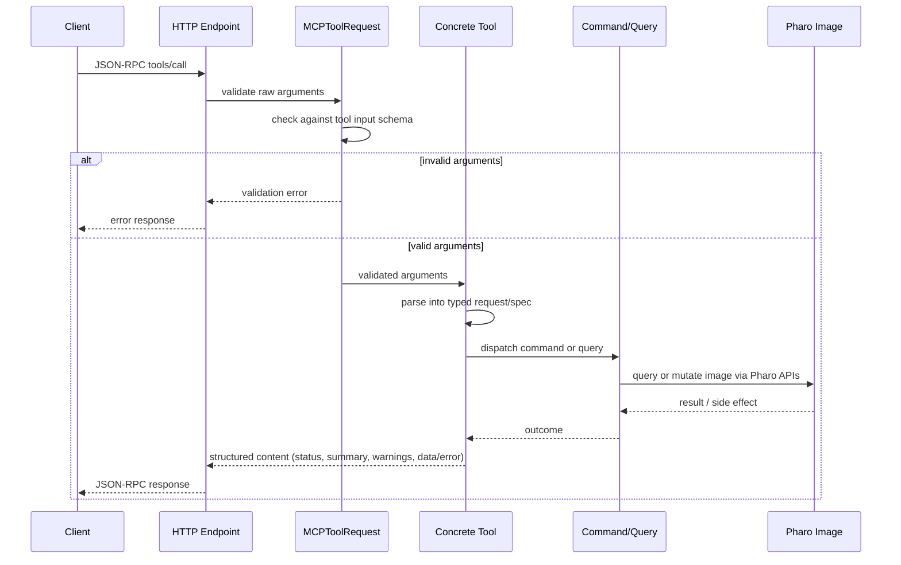

# Safety And Ecosystem Integration

MCP is safest when callers use the dedicated tools before falling back to raw
evaluation. The tools are built around Pharo's normal development systems, so an
agent works through image-aware operations instead of editing exported source
text blindly.

## Tool Boundary

Each tool owns its MCP metadata:

- name and title
- description
- icon
- input JSON schema
- output JSON schema

The execution path is:

1. The HTTP endpoint receives a JSON-RPC `tools/call`.
2. `MCPToolRequest` validates raw arguments against the tool input schema.
3. The concrete tool parses the request into a typed request or spec object.
4. The tool dispatches a command or query object.
5. The command uses Pharo APIs to query or mutate the image.
6. The tool returns a payload with `summary`, `warnings`, and either `data` or
   `error`, with a failure flagged by the protocol's own `isError`. By default
   this payload reaches the MCP `content` field; the server can also emit
   `structuredContent` for clients that need programmatic results.

### Notifications

A notification is not a failed call. Pharo signals them for remarks rather than
faults, and every `Warning` is one. The tool boundary resumes them with the
value the image itself would have produced and the call proceeds, so a
deprecated send, or an undeclared variable during a package load, does not fail
it. A deprecated method called from a test does not abort the suite.

Refactoring warnings are the exception. `RBRefactoringWarning` reports a change
that breaks something, so it reaches the boundary unresumed and stops the call,
aborting a removal or a rename that `force=true` did not authorize.



This keeps transport parsing, schema validation, image operations, and result
formatting in separate places.

## Refactorings

Class and method edits use Refactoring Browser and Refactoring Engine operations
where Pharo owns the behavior.

Examples include:

- class rename with `ReRenameClassRefactoring`
- class removal with `ReRemoveClassRefactoring`
- method rename with `ReRenameMethodRefactoring`
- argument add/remove with `RBAddParameterRefactoring` and
  `RBRemoveParameterRefactoring`
- slot add, remove, rename, pull-up, and push-down with the corresponding
  instance-variable refactorings
- method batch removal with `ReRemoveMethodsRefactoring`

When a refactoring raises `RBRefactoringWarning`, the default behavior is to
stop. The tool result includes:

```text
impactMessages
howToProceed
forceSupported: true
```

Review the impact and rerun the same request with `force=true` only when the
warning is acceptable. When forced, the warning messages are returned in the
normal `warnings` array.

## Critiques

`method_compile` compiles method source in the image and returns selected Renraku
critiques in the structured result. It includes error-severity critiques and a
small set of non-error rules that are useful after automated edits, such as
excessive arguments, missing super sends, return in ensure, temporary variable
overrides, and unary accessing methods without returns.

Critiques include:

- Renraku rule class
- title
- description
- source interval when available

The method may compile successfully and still return critiques. Treat critiques
as follow-up review evidence, not as transport failures.

## Rewriting Methods

`method_rewrite` uses Smalltalk AST rewrite patterns, not regex. A rule has a
`match` and a `replacement`, and a scope is required, so rewriting everything is
something a caller asks for by naming the packages rather than by leaving an
argument out.

A metavariable starts with a backquote and stands for whatever is in its place.
`` `@receiver `` matches one expression, however big: the same rule rewrites
`anObject notNil` and `(anObject foo) notNil`. **The names must be the same on
both sides** — a name that appears only in `replacement` is bound to nothing.

The default mode is preview, which carries the old and new source of every
change:

```json
{
  "rules": [
    {
      "match": "`@receiver notNil",
      "replacement": "`@receiver isNotNil"
    }
  ],
  "scope": { "packages": ["MyPackage"] }
}
```

A metavariable stands for a block just as readily, which is how a rule drops
one branch of a conditional:

```json
{
  "rules": [
    {
      "match": "`@receiver ifTrue: [ `@body ] ifFalse: [ nil ]",
      "replacement": "`@receiver ifTrue: [ `@body ]"
    }
  ],
  "scope": { "packages": ["MyPackage"] }
}
```

Add `apply` to make the changes. One call is enough; preview first only when
you want to read them before they land. `history_entry_revert` undoes a rewrite
that turned out wrong.

A critique rule stands for its own patterns, so its name can be given instead
of writing them out:

```json
{
  "ruleClasses": ["MCPCollectionThenDoRule"],
  "scope": { "packages": ["MyPackage"] },
  "apply": true
}
```

Rules that report a critique are not applied by the tools that compile. A
compile reports what it would change; changing it is this tool's job, and the
caller asks.

## Tests And Coverage

`test_run` runs SUnit classes or individual methods and returns structured test
results. Use `test_coverage_run` when the same test run should collect
CoverageCollector method and node coverage for an explicit method scope.
`test_run` deduplicates concrete test cases across a batch. Use
`selectedTestCount` for selected unique tests, `runCount` for non-skipped
executed tests, and `skippedCount` for skipped tests.

Coverage output includes method counts, node counts, uncovered methods,
partially covered methods, and optional covered method details. Use it after
edits to ask whether the relevant methods were exercised.

## Repository Work

MCP uses Iceberg for repository state. The repository tools can:

- list registered repositories and their branch, head, package, modified, and
  remote metadata
- load Metacello baselines
- create image-side repository registrations or update their metadata,
  including registrations for linked Git worktree checkouts
- inspect `workingCopyDiff`
- verify expected repository identity before edits or exports
- export image changes to Tonel files
- commit, fetch, pull, push, create branches, and switch branches

Use `repository_identity_verify` before edits or exports, and
`repository_change_list` before exporting or committing. Use
`repository_create`, `repository_attach`, and `repository_update` for repository
registration workflows. Export writes image changes to disk and updates the
Iceberg index; it does not stage or commit Git changes.

## Change History

MCP uses Epicea change history. `history_file_list` lists `.ombu`
files, and `history_entry_list` lists entries from the current history
or a selected file. `history_entry_apply` and `history_entry_revert` preview
selected entries, and perform the selected apply or revert only when
`confirm=true`.

Use this when recovering image-side changes or preparing a clean handoff from a
live image back to Tonel/Git.

## Debugging

Debugger tools are discoverable through the `debugging` group. They keep no
state: `debug_watch` installs non-halting probes and removes them before it
answers, and `debug_search` only reads the debuggers a person has open.

A debugger somebody opened belongs to them. Read it, then act with the ordinary
class and method tools; do not step, resume or terminate it.

## Evaluation Escape Hatch

`image_evaluate` runs arbitrary Smalltalk in the running image without saving
it. It is useful for short inspection or glue code when no dedicated tool
exists.

Prefer a dedicated tool when one exists, because the dedicated tools validate
input, return structured result data, and often use safer Pharo APIs.

Compiling source is one of those cases. Method source in the image separates
lines with CR, and `method_compile` normalizes what it is given; a bare
`compile:` from `image_evaluate` stores whatever it receives, so source written
with LF compares unequal to every other method in the image. Use
`method_compile` for a method, and `withInternalLineEndings` if you must compile
source by hand.

## Observability And UI

The Spec dashboard is available from an inspected `MCP` object. It shows:

- server status and port
- debug mode
- registered tools and descriptions
- observability status
- per-tool timing metrics
- traces for errors, outliers, and output overruns
- recent logs

MCP starts with the built-in JSON observability backend enabled. Disable it for
a specific server when its local metrics, traces, and logs are not wanted:

```smalltalk
mcp observabilityEnabled: false
```

By default, JSON observability exports under the image-local
`pharo-local/mcp/observability` directory. Configure
`mcp observabilityExportDirectory: aDirectory` to override that export root for
instance metadata, `logs.jsonl`, `metrics.json`, and `traces.jsonl`.

OpenTelemetry support is optional. Load the `Telemetry` group, then enable
the OpenTelemetry backend for an MCP instance:

```smalltalk
Metacello new
   baseline: 'MCP';
   repository: 'github://Evref-BL/MCP:main/src';
   load: 'Telemetry'.

mcp useOpenTelemetryObservability
```

## Version Compatibility

The core baseline loads PharoBackwardCompatibility, JRPC, and PCRE2.
OpenTelemetry is loaded only by the optional `Telemetry` group. CI covers
Pharo 12, 13, and 14. Code should target the Pharo 14 API; PharoBackwardCompatibility
backports supported APIs to older images.
